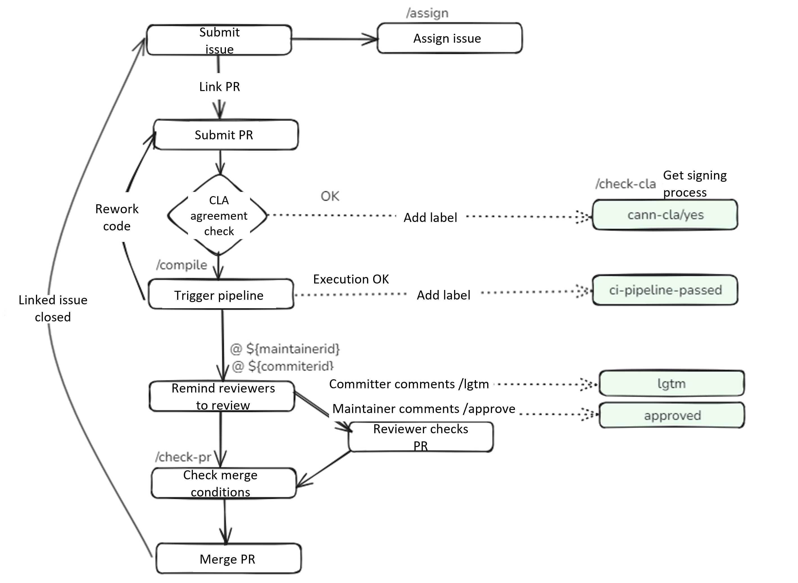

# Community User Interaction Flow and Interaction Commands

<!-- md-trans-meta sourceCommit=1e6f03bd2342816177a05a974fb297810ba2b376 translatedAt=2026-10-10T12:21:34.264Z pushedAt=2026-10-14T10:12:49.247Z -->

## 🚀CANN Community User Interaction Flow

All projects in the CANN community are maintained by Bot. This means developers can trigger Bot commands by commenting under each Pull Request or Issue. The main interaction flow diagram is as follows:

## 🎯 Command Details

<table class="command">
    <thead>
        <tr>
            <th width="15%">Command</th>
            <th width="15%">Example</th>
            <th width="10%">Scope</th>
            <th width="30%">Description</th>
            <th width="15%">Target Audience</th>
            <th width="15%">Repository</th>
        </tr>
    </thead>
    <tbody>
        <tr>
            <td>                /check-cla
            </td>
            <td style="white-space:nowrap;">                /check-cla
            </td>
            <td>                <strong>Pull Request</strong>
            </td>
            <td>                Forces a re-check of the CLA status of the Pull Request.
                If the submitter of the Pull Request has already signed the CLA, the <strong>cann-cla/yes</strong> label is added to the Pull Request; otherwise, the <strong>cann-cla/no</strong> label is added to the Pull Request.
            </td>
            <td>                All Developers
            </td>
            <td>                All Repositories
            </td>
        </tr>
        <tr>
            <td>                /cla cancel
            </td>
            <td style="white-space:nowrap;">                /cla cancel
            </td>
            <td>                <strong>Pull Request</strong>
            </td>
            <td>                Forcefully delete the <strong>cann-cla/yes</strong> label.
            </td>
            <td>               Repository Administrator
            </td>
            <td>                All Repositories
            </td>
        </tr>
        <tr>
           <td>                compile
           </td>
           <td style="white-space:nowrap;">                compile
           </td>
           <td>                <strong>Pull Request</strong>
            </td>
           <td>                Triggers a build of the CodeArts pipeline. After the build succeeds, the Pull Request is labeled with <strong>ci-pipeline-passed</strong>. If the build fails, the Pull Request is labeled with <strong>ci-pipeline-failed</strong>.
           </td>
           <td>              All Developers
           </td>
           <td>              All Repositories
           </td>
        </tr>
        <tr>
            <td>                /lgtm
            </td>
            <td style="white-space:nowrap;">                /lgtm
            </td>
            <td>                <strong>Pull Request</strong>
            </td>
            <td>                Adds the <strong>lgtm</strong> label, which indicates that the code has been reviewed.
            </td>
            <td>              Reviewers of the SIG group that owns the repository
            </td>
            <td>                All Repositories
            </td>
        </tr>
        <tr>
            <td>                /lgtm cancel
            </td>
            <td style="white-space:nowrap;">                /lgtm cancel
            </td>
            <td>                <strong>Pull Request</strong>
            </td>
            <td>                Removes the label <strong>lgtm</strong> used to indicate that the code has been reviewed.
            </td>
            <td>                Reviewers of the SIG group that owns the repository
            </td>
            <td>                All Repositories
            </td>
        </tr>
        <tr>
            <td>                /approve
            </td>
            <td style="white-space:nowrap;">                /approve
            </td>
            <td>                <strong>Pull Request</strong>
            </td>
            <td>                Adds the label <strong>approved</strong> used to indicate that committers approve the merge.
            </td>
            <td>              Committers of the SIG group that owns the repository
            </td>
            <td>                All Repositories
            </td>
        </tr>
        <tr>
            <td>                /approve cancel
            </td>
            <td style="white-space:nowrap;">                /approve cancel
            </td>
            <td>                <strong>Pull Request</strong>
            </td>
            <td>                Removes the <strong>approved</strong> label used to represent committers' approval to merge.
            </td>
            <td>              Committers of the SIG group that owns the repository
            </td>
            <td>                All Repositories
            </td>
        </tr>
        <tr>
            <td>                /check-pr
            </td>
            <td style="white-space:nowrap;">                /check-pr
            </td>
            <td>                <strong>Pull Request</strong>
            </td>
            <td>                Checks whether the labels in the Pull Request meet the conditions. If so, the Pull Request is merged.
            </td>
            <td>                Anyone can trigger this command on a Pull Request.
            </td>
            <td>                All Repositories
            </td>
        </tr>
        <tr>
            <td>                /merge
            </td>
            <td style="white-space:nowrap;">                /merge
            </td>
            <td>                <strong>Pull Request</strong>
            </td>
            <td>                Adds the label <strong>keeper_approved</strong> to represent the branch_keeper's approval of the merge.
            </td>
            <td>                The branch_keeper of the corresponding branch of the repository.
            </td>
            <td>                All Repositories
            </td>
        </tr>
        <tr>
            <td>                /kind **
            </td>
            <td style="white-space:nowrap;">                /kind bug
                 **Accepts uppercase and lowercase letters, digits, hyphens, and underscores.
                 The following** rules apply generally.
            </td>
            <td>                <strong>Pull Request</strong>
                 <strong>Issue</strong>
            </td>
            <td>                Adds the label <strong>kind/bug</strong>.
            </td>
            <td>                Repository administrators can add it directly. Other members can add a label through a comment, such as kind/AI, provided that the label already exists in the repository; otherwise, the label cannot be added.
            </td>
            <td>                All Repositories
            </td>
        </tr>
        <tr>
            <td>                /remove-kind **
            </td>
            <td style="white-space:nowrap;">                /remove-kind bug
            </td>
            <td>                <strong>Pull Request</strong>
                 <strong>Issue</strong>
            </td>
            <td>                Removes the label <strong>kind/bug</strong>.
            </td>
            <td>                All Members
            </td>
            <td>                All Repositories
            </td>
        </tr>
        <tr>
            <td>                /priority **
            </td>
            <td style="white-space:nowrap;">                /priority high
            </td>
            <td>                <strong>Pull Request</strong>
                 <strong>Issue</strong>
            </td>
            <td>                Add the label <strong>priority/high</strong>.
            </td>
            <td>                Repository administrators can add it directly; other members can add a label through a comment, such as kind/AI, provided that the label already exists in the repository; otherwise, the label cannot be added.
            </td>
            <td>                All Repositories
            </td>
        </tr>
        <tr>
            <td>                /remove-priority **
            </td>
            <td style="white-space:nowrap;">                /remove-priority high
            </td>
            <td>                <strong>Pull Request</strong>
                 <strong>Issue</strong>
            </td>
            <td>                Remove the label <strong>priority/high</strong>.
            </td>
            <td>                All Members
            </td>
            <td>                All Repositories
            </td>
        </tr>
        <tr>
            <td>                /sig **
            </td>
            <td style="white-space:nowrap;">                /sig AI
            </td>
            <td>                <strong>Pull Request</strong>
                 <strong>Issue</strong>
            </td>
            <td>                Add the label <strong>sig/AI</strong>.
            </td>
            <td>                Repository administrators can add labels directly; other members can add labels by commenting, such as kind/AI, provided that the label already exists in the repository; otherwise, the label cannot be added.
            </td>
            <td>                All Repositories
            </td>
        </tr>
        <tr>
            <td>                /remove-sig **
            </td>
            <td style="white-space:nowrap;">                /remove-sig AI
            </td>
            <td>                <strong>Pull Request</strong>
                 <strong>Issue</strong>
            </td>
            <td>                Remove Label <strong>sig/AI</strong>.
            </td>
            <td>                All Members
            </td>
            <td>                All Repositories
            </td>
        </tr>
        <tr>
            <td>                /assign [[@]...]
            </td>
            <td style="white-space:nowrap;">                /assign
                 /assign @cann-robot
            </td>
            <td>                 <strong>Issue</strong>
            </td>
            <td>                Assign an owner to the issue.
            </td>
            <td>                All Members
            </td>
            <td>                All Repositories
            </td>
        </tr>
        <tr>
            <td>                /unassign [[@]...]
            </td>
            <td style="white-space:nowrap;">                /unassign
                 /unassign @cann-robot
            </td>
            <td>                 <strong>Issue</strong>
            </td>
            <td>                Unassigns the owner of the issue.
            </td>
            <td>                All Members
            </td>
            <td>                All Repositories
            </td>
        </tr>
    </tbody>
</table>
